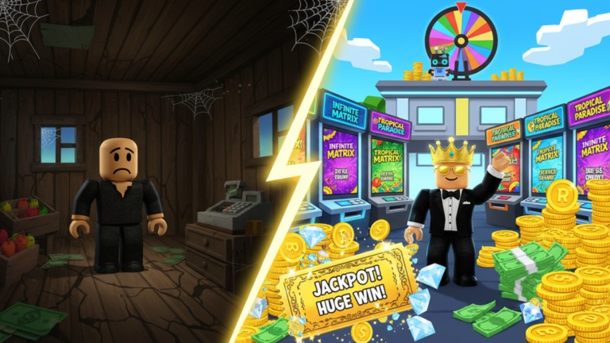
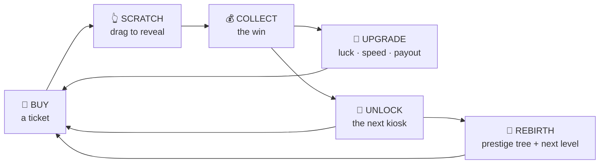
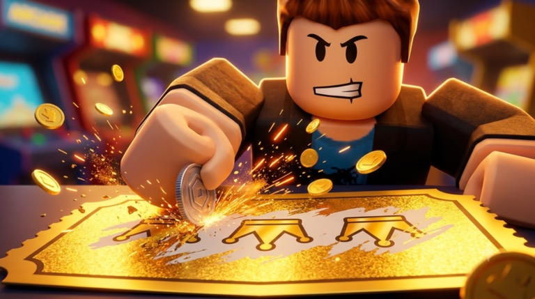
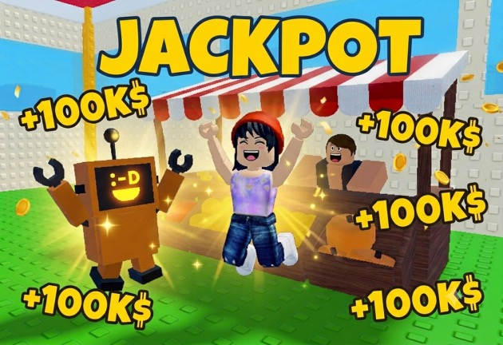
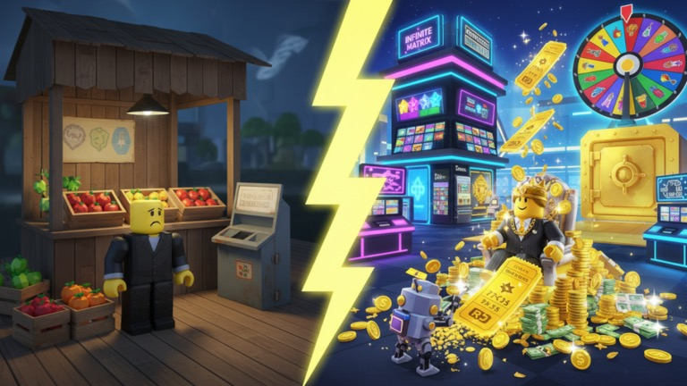
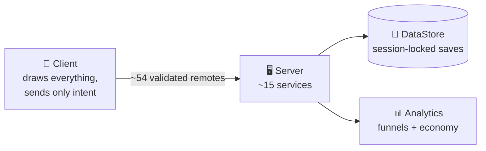

  

<h1 align="center">
   &nbsp;Lucky Ticket Tycoon
</h1>

  <b>Scratch tickets. Win prizes. Grow a tiny fruit stand into a ticket empire.</b> 
  A live Roblox tycoon, designed and built by one developer working with AI.

  
  
  
  

---

## 🎮 The game

You start with a dusty fruit stand and one ticket. **Drag your finger across the card to scratch it**, cell by cell, and see what's underneath: a match, a multiplier, a jackpot, or a bomb. Wins pay for upgrades, upgrades pay for new kiosks, and new kiosks grow your shop a floor at a time. When you hit the top of a level, you **rebirth** for permanent power and open the next one.

<table>
  <tr>
    <td width="50%"></td>
    <td width="50%"></td>
  </tr>
</table>

## ✨ What's inside

| | |
|---|---|
| 🎫 **Real scratching** | You actually scratch. Each cell clears under your finger, with a gold pop per cell, a red flash and a shake on bombs, and confetti on a jackpot. |
| 🃏 **6 card types** | Match-3, multiplier reveal, treasure hunt, penalty kicks, scratch-to-win, and per-symbol cards where every tile pays and bombs take away. |
| 🏪 **20 themed kiosks** | Fruit Stand, Bakery Delight, Deep Sea Diver, Retro Arcade, Dino Dig, Spooky Graveyard, Cyberpunk Neon, Ancient Egypt, Wizard's Lab, Atlantis, Cosmic Nebula, Mount Olympus… up to **The Infinite Matrix**. |
| 🪜 **5 levels × 4 kiosks** | Unlock kiosks with cash inside a level, then rebirth to reach the next one. |
| 🌳 **Prestige tree** | 16 permanent nodes across Luck, Cash, Unlocks, Automation and Meta. The math is checked so that maxing it fits what a normal run earns. |
| 🤖 **Scratch Bot** | A robot pet that scratches for you, banks its earnings and keeps working offline. |
| 🏢 **Your building grows** | Every player has a plot on a shared plaza, and their shop gains a floor as they progress. |
| 🔥 **Server Hype** | Everyone's scratches fill one meter, and when it's full, GOLDEN HOUR pays the whole server more. |
| 🎡 **Come back daily** | A 7-day login grid, a free prize-wheel spin every 30 minutes, daily and weekly tasks, collections and cosmetic foils. |

## 🧠 Design for kids, done responsibly

A scratch-ticket game for kids has to be careful, and this one was designed that way from day one:

- **Odds on every card.** Each ticket lists every symbol's chance and payout, and the multiplier you see is the multiplier you're paid.
- **No wager words anywhere** (bet, lottery, casino, gamble) in the game or its store page.
- **Robux never buys luck.** Purchases remove waiting and repetition. Nothing for sale raises odds, expected value or income rate.
- **Cosmetics are only cosmetic.** Foils and reveal effects have zero gameplay effect.
- **You can't get stuck.** The first kiosk is free, so a player can never sit at $0 with nothing to do.

## 🛠️ How it's built

- **Server-authoritative.** About 15 services (Data, Economy, Tickets, Plots, Rebirth, Prestige, Automation, Engagement, Tasks, Tutorial, Social, Cosmetics, Monetization, Leaderboards) are wired together with dependency injection. The server rolls every outcome before the card appears. The client never decides anything.
- **Data you can't lose.** Saves are session-locked and claimed atomically, with stale-lock recovery, retries and autosave, plus a read-only mode if a load ever fails. All of it was tested against the real DataStore with planted fake locks.
- **One balance file.** Kiosks, odds, upgrade curves, the rebirth ladder, the wheel and products all live in one config. Each kiosk's odds are normalised to a target return, checked by an economy workbook.
- **Anti-exploit.** Every remote validates its arguments, every action is rate-limited, and wins are collected by hand. A QA play-through confirmed a $0 exploit gain.
- **Built for phones.** All UI is built in code, with responsive scaling, touch-safe buttons and one modal system with a shared dim overlay.
- **Instrumented.** A first-time-player funnel (spawn → first scratch → first collect → first upgrade → first unlock → first rebirth), time-to-first-rebirth, every cash, gem and prestige-point source and sink, and upsell conversion.

### How I worked

Every session followed one rhythm, **Plan → Confirm → Build → Verify**, under a standing rule: *no silent partials*. Each task ends **DONE** with evidence, **PARTIAL** with what's missing, or **BLOCKED** with a question. UI ships styled or not at all, and every UI change comes with a phone-sized screenshot checked against a six-point list.

The project behind it: 60+ design specs, economy and math-verification reports, monetization audits, QA sweeps, a numbered bug log, and a launch and paid-ads plan.

## 🧰 Tech

**Roblox Studio + Luau** · **DataStore / OrderedDataStore** · **MarketplaceService** (passes + developer products) · **AnalyticsService** · **Claude Code**

---

  The source code is private. This repo is a showcase. 
  Made by <b>Ido Siloni</b> · 2026 · also by me: <a href="https://github.com/Idosiloni/Spin-To-Fly">+1 Spin to Fly</a> · <a href="https://github.com/Idosiloni/Fight-To-Steal">Fight to Steal</a>

